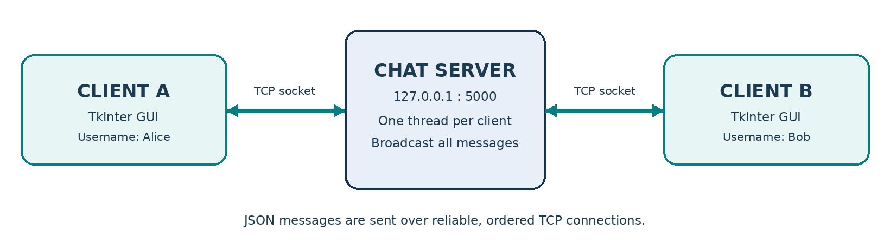

# Real-Time Chat Application Using TCP/IP Socket Programming

**Computer Networks Lab Project** | Python 3 | TCP/IP | Socket Programming | Tkinter GUI

## 1. Project Title
Real-Time Chat Application Using TCP/IP Socket Programming

## 2. Project Description
NetworkLab Messenger is a desktop group-chat application built with Python. A multithreaded TCP server listens for connections, manages usernames, and broadcasts chat messages to connected clients. Users interact through a Tkinter graphical interface. The project demonstrates a client-server architecture, TCP socket connections, ports, concurrent clients, and reliable ordered data transmission.

The default lab demo runs on `127.0.0.1:5000` with two client windows on one computer.

## 3. Features
- Multiple users join a common chat room using unique usernames.
- Two-way real-time group messaging using TCP sockets.
- Graphical user interface with message text box and Send button.
- Connected users shown in a live online-user list.
- Connect and Disconnect controls, join/leave status updates, timestamps.
- A background receive thread on each client and a threaded server.
- Message-length and username validation; duplicate usernames rejected.
- Runs entirely with the Python standard library, without databases or external packages.

## 4. Software Requirements
- Python 3
- Windows 10/11, or macOS/Linux with Tkinter support
- Visual Studio Code (recommended) or any code editor
- Python standard-library modules: `socket`, `socketserver`, `threading`, `tkinter`, `queue`, `json`, `re`, `argparse`, `datetime`

No `pip install` is required. Python 3 must be available in the terminal. On some Linux distributions, install the OS package `python3-tk` if needed.

## 5. Steps to Run the Project

### Option A: Run using VS Code (recommended)
1. Download or clone this repository and open its root folder in VS Code.
2. Open Terminal 1 and run:
   ```powershell
   python server.py
   ```
3. Keep the server terminal open. It will show `Listening on 127.0.0.1:5000`.
4. Open Terminal 2 and run:
   ```powershell
   python client.py
   ```
5. Enter username **Alice**, keep Server IP `127.0.0.1` and Port `5000`, and click **Connect**.
6. Open Terminal 3 and run `python client.py` again.
7. Enter username **Bob** and click **Connect**.
8. Send `Hello Bob!` from Alice. Reply `Hi Alice!` from Bob. Messages appear in both windows.
9. Disconnect a user and watch the Online users list update.

If `python` is not available, try `py -3` on Windows or `python3` on macOS/Linux.

### Option B: One-click Windows launcher
Double-click `START_DEMO_WINDOWS.bat`. It opens the server and two clients. Enter different usernames and connect.

### Automatic tests
```powershell
python test_chat.py
```
Tests cover joining, broadcast, user-list updates, rejecting duplicate names, and leaving the chat.

## 6. Project Architecture



The clients send newline-delimited JSON messages through TCP sockets. The server maintains a mapping of connected handlers to usernames and forwards a received message to every active client. A queue transfers background networking events to the Tkinter main thread.

## 7. Screenshots

### Server listening


### Working chat: Alice and Bob


Both images were captured from the working project demonstration.

## 8. Repository Files
- `server.py` - multithreaded TCP server.
- `client.py` - graphical Python chat client.
- `test_chat.py` - automated networking test.
- `START_DEMO_WINDOWS.bat` - Windows demo launcher.
- `ARCHITECTURE_DIAGRAM.png` - architecture illustration.
- `SCREENSHOT_SERVER_RUNNING.png`, `SCREENSHOT_CHAT_WORKING.png` - demonstration evidence.
- `Computer_Networks_Lab_TCP_Chat_Project_Report.pdf` - formatted academic report.
- `Computer_Networks_Lab_TCP_Chat_Project_Report.docx` - editable academic report.

## 9. Limitations and Safety
This lab demo has no user authentication, message encryption, or persistent history. It is intended for local/offline use or a trusted LAN, not for public internet deployment. Never expose port 5000 through a router to the open internet without hardening the application.

## 10. Project Outcome
Two clients (Alice and Bob) successfully connect to the same TCP server, exchange messages, and display an updated list of online participants. This demonstrates basic socket programming and client-server communication in Computer Networks.
